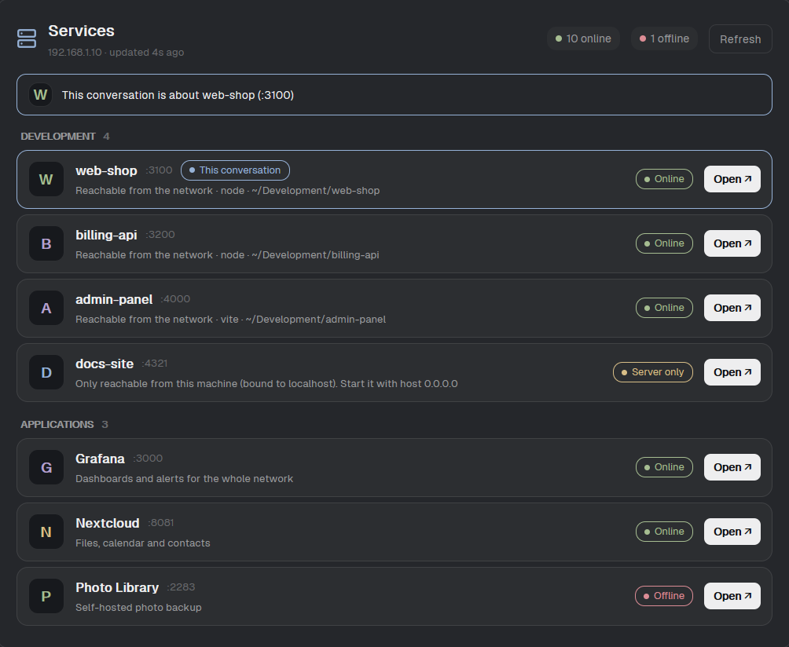
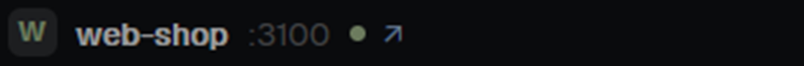

# Services for Herdr

The services running on your home server, one click away in [Herdr](https://herdr.dev): a **Services** dialog with a card per service (icon, state, links) and a **status-bar shortcut** that shows the service of the project you are working on.



When the focused terminal is a Claude Code conversation on the server, the shortcut works out which project folder that conversation is about and shows its service. One click opens it in the browser.



## What it does

- **Dialog** (`ctrl-shift-u`, or the shortcut's server icon): services grouped by category, a coloured state pill (Online, Offline, Server only), a link button per URL, a summary of how many are up, a Refresh button. Refreshes by itself.
- **Shortcut** in the status bar: `☰ Services` normally. In a Claude Code conversation on the server it becomes the project's service, for example `web-shop :3100 ● ↗`. The name opens the service, the server icon opens the dialog.
- **Icons are found for you**: it asks the dashboard for its icon file, then reads the `<link rel="icon">` tags of the service's page, then tries `/favicon.svg`, `/apple-touch-icon.png`, `/favicon.png` and `/favicon.ico`. What it finds is cached in `data/service-icons/`. A service with no icon gets a coloured letter tile.
- **Links follow the server's IP**: by default it asks the server for its LAN address on every refresh, or you set the address yourself.

## Needs a dashboard

The mod reads a small JSON API served **on the server** (it never opens a port to your computer; the requests go through the Herdr machine). It was built for a home-server dashboard that exposes:

| Path | Returns |
|---|---|
| `GET /api/services` | `[{ id, name, category, description, port, icon?, iconUrl?, urls: [{ label, url }] }]`. `icon` may be `desktop`, `network` or `docker`; `iconUrl` is a path on the dashboard such as `/icons/app.svg`. |
| `GET /api/health` | `[{ id, online }]`, one per service id. Optional: without it the state shows as unknown. |
| `GET /api/dev-services` | `[{ id, name, description, port, loopbackOnly, urls }]`: listening ports of projects under your development folder, `name` being the project folder. Optional: without it there is no Development group and the shortcut has nothing to match. |

URLs that point at `127.0.0.1` or `localhost` are rewritten to the server's address. If you have no such dashboard, the mod will show an error; try **demo mode** (below) to see how it looks.

## Install

Needs Herdr with a machine added for your server (`hc machine ls`).

1. Copy `mods/services` and `mods/services-button` into `~/.config/herdr-app/mods/` (on Windows `%USERPROFILE%\.config\herdr-app\mods`).
2. Add the key from `keys.json` to your `~/.config/herdr-app/keys.json`, or pick another one.
3. Put the shortcut in the status bar. Clone your layout first (shipped layouts are read-only): `herdr-app do layout.clone '{"name":"main","as":"my-main"}'`. Then in `layouts/my-main.json` replace the `status` block by a row (the 330 px block is the shortcut):

   ```json
   { "id": "status-row", "type": "row", "size": { "px": 28 }, "resizable": false, "children": [
     { "id": "status", "type": "block", "size": { "weight": 1 }, "content": { "mod": "workspace-status" } },
     { "id": "services-button", "type": "block", "size": { "px": 330 }, "content": { "mod": "services-button" } }
   ] }
   ```

4. Check them: `herdr-app check ~/.config/herdr-app/mods/services` and the same for `services-button`.

With an agent: *Read ~/.config/herdr-app/AGENTS.md, then add this mod: `https://github.com/moicheabraham-ui/herdr-services`*.

## Configure

Optional. Copy `mods/services/config.example.json` to `mods/services/config.json` and change what you need. It is read again on every refresh, so changes apply within seconds. `config.json` is git-ignored, so your settings are never committed.

| Key | Default | Meaning |
|---|---|---|
| `machine` | `""` | The Herdr machine the services run on (a name from `hc machine ls`). Empty uses the first machine. |
| `host` | `""` | The address used in links and icon lookups, for example `192.168.1.10` or `server.lan`. Empty asks the server for its LAN address each time. Set it when the server has several addresses or you use a name. |
| `dashboardPort` | `7500` | The port of the dashboard on the server. |
| `devRoot` | `"Development"` | The folder under the server's home that holds your projects. |
| `refreshSeconds` | `10` | How often the list is refreshed (2 or more). |
| `demo` | `false` | Show made-up services instead of a server. Used for the screenshots. |

Values are checked: `host` and `devRoot` accept only plain characters, and a broken `config.json` is reported in the dialog while the defaults stay in force.

## What it runs and reads

You should know before you add it:

- **On the server**, through the Herdr machine: `curl` to the dashboard on `127.0.0.1`, `ip route get` for the server's address, and, for the shortcut, a short `sh` script that reads the end of the focused Claude Code conversation (`~/.claude/sessions/<pid>.json` and the session's transcript) to count which project folders it mentions. Nothing from the conversation is kept or sent anywhere.
- **On your computer**: `hc get` for the focused terminal, and `curl` to the services' own pages and dashboard to find icons (plain GET requests, images only, 600 KB at most, 4 s timeouts).
- **Files**: reads `mods/services/config.json`; writes icons into `data/service-icons/` under the Herdr folder.
- It makes **no requests to the internet** other than the links your services themselves declare for their icons (for example a service whose configured URL is a public domain).

## Troubleshooting

- *"dashboard /api/services: curl exit 7"*: nothing answers on the server at `dashboardPort`.
- *"No server machine"*: add the server as a Herdr machine, or set `machine`.
- The shortcut only shows a service for **Claude Code** conversations on the server, and only when they mention a folder that matches a service. Other agents match by their working folder.
- To remove it: delete the two mod folders and the layout block, and `data/service-icons/`.

## Credits and licence

MIT, see [LICENSE](LICENSE). The four line icons are simple outlines in the style of Feather icons, drawn for this project.
