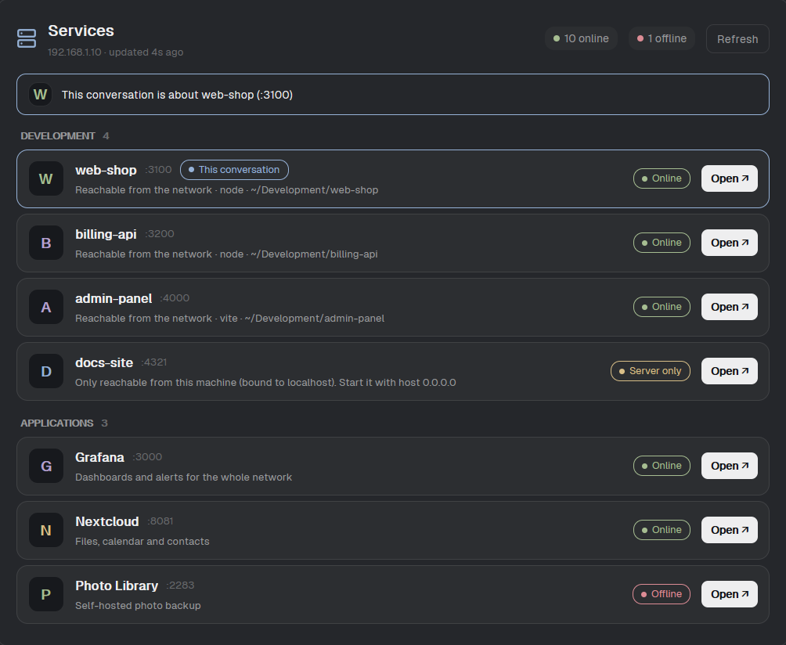

# Services

A dialog and a status-bar shortcut for the services running on a home server. The dialog lists every service the server's dashboard knows, as cards with an icon, a state and link buttons. The shortcut shows the service of the project the focused Claude Code conversation is about, and opens it with one click.

## What you see

- **Dialog**, 840 px wide and 80 % of the window high, background `popover`, 18 px padding, 14 px gaps. A header: a 22 px server glyph in `accent`, "Services" 17 px semibold with "<server address> · updated Ns ago" 11 px `dim` below it, a chip "N online" (7 px `ansi2` dot) and, only when any, "N offline" (`ansi1` dot), and a bordered "Refresh" button. Under it, only when the focused conversation matches a service, a bordered (`accent`) banner: a 26 px tile and "This conversation is about <name> (:port)". Then a scrolling list grouped by category in the order Development, Applications, AI, Infrastructure, Management, others last. A group heading is the upper-cased name in 10.5 px semibold `muted` with its count in `dim`.
- **Card**: radius 12, `raised` background, 1 px `border` (`accent` for the matching service), 12 px/10 px padding, 12 px gaps. A 38 px rounded tile (`surface`, 1 px `border`): the service's logo at 24 px, or a 20 px line icon in `accent`, or the first letter in 16 px semibold in one of `ansi1..6` chosen by hashing the name. Next to it the name (13.5 px semibold), its `:port` (11 px `dim`), a "This conversation" pill when it matches, and the description (11 px `muted`, one line). On the right a state pill (Online `ansi2`, Offline `ansi1`, Server only `ansi3`, Unknown `dim`; a 6 px dot and 10.5 px text on a 1 px outline) and one solid button (`solid` / `solid_foreground`, 11.5 px semibold) per URL, labelled "<label> ↗".
- **Shortcut**, a block 330 px wide at the right end of the 28 px status bar, `chrome` background, 1 px `border` top line, 11.8 px `muted` text. Without a match: a 12 px server glyph and "Services", centred. With one: an 18 px badge (logo, line icon or letter), the name (`foreground`, semibold), `:port` (`dim`), a 6 px state dot and a `↗` in `accent`; at its right edge a 12 px server glyph in its own 9 px-padded cell.

## How it behaves

- The shortcut's **fetcher** (`services-button`, always on screen) loads the data every `refreshSeconds` and keeps it in shared state `services.data`; the dialog only draws it. Refresh in the dialog sets `services.refresh`, which makes the fetcher reload at once. The fetcher publishes the matching service's key as `services.current`.
- **Loading**: on the Herdr machine, `curl` to `http://127.0.0.1:<dashboardPort>` for `/api/services`, `/api/health` and `/api/dev-services`, plus `ip -4 route get 1.1.1.1` for the server's LAN address (unless `host` is set). URLs on `127.0.0.1` or `localhost` are rewritten to that address. A failed load keeps the last list and shows the error in red under the header; the next tick tries again.
- **State**: from `/api/health` for dashboard services (Online, Offline, or Unknown when absent); Development services are Online, or "Server only" when bound to loopback.
- **Matching a conversation** (only for the focused terminal when its space is on the server's machine): the project is the folder under `devRoot` in the terminal's working directory, else, for a Claude Code terminal, the project named most often among the newest 80 `/<devRoot>/<name>` paths in the last 400 KB of the conversation's transcript (the latest breaks a tie). The transcript is found through the terminal's process id in `~/.claude/sessions/<pid>.json`. The service is then the Development entry of that name, preferring a port reachable from the network, then the lowest port; failing that, a dashboard service whose id or name matches. It re-checks every 5 s tick and when the focused terminal changes.
- **Icons**: for each service without one, once per hour at most and four at a time: the dashboard's `iconUrl`, the `<link rel="icon">` tags of the service's page (SVG, then PNG, WEBP, JPEG, ICO), then `/favicon.svg`, `/apple-touch-icon.png`, `/favicon.png`, `/favicon.ico` on its origin; the pages tried are `http://<address>:<port>/` and the service's URLs. Only `image/*` responses of 600 KB or less are kept, in `data/service-icons/<key>.<ext>`; earlier finds are loaded at start.
- **Clicks**: a link button, or the shortcut's name, opens the URL in the browser. The shortcut's server glyph (or the whole shortcut when nothing matches) runs `mod.open services`, which closes the dialog if it is open.

## Built from

- `mods/services/` (`mod.json`: `place: none`, a dialog overlay 840 wide and 0.8 high; `main.js`: the dialog; `icons/`: `generic`, `desktop`, `network`, `docker` line icons; `config.example.json`).
- `mods/services-button/` (`mod.json`: `place: none`; `main.js`: config, fetching, icon search, matching and the shortcut).
- `keys.json`: `{ "global": { "ctrl-shift-u": "mod.open:services" } }`.
- Layout: a clone of `main` whose `status` block becomes a row, `workspace-status` (weight 1) and `services-button` (330 px).
- `herdr`: `exec` (with `on` for the server), `run` (`mod.open`), `focused`, `spaces`, `machines`, `shared`, `setShared`, `readTextFile`, `appHome`, `theme`, `checking`. `fs/promises`: `mkdir`, `readdir`, `unlink`. `gpui-kit`: `image`, `svg`.
- Settings in `mods/services/config.json` (see the README): `machine`, `host`, `dashboardPort`, `devRoot`, `refreshSeconds`, `demo`.

## Watch out

- The server must serve the dashboard API on its own loopback; the mod never connects to it from the computer.
- `exec` without `on` runs on this computer, so every server command passes `{ on: machine }`.
- `image()` and `svg()` take paths relative to the Herdr folder, not to the mod.
- No `setTimeout`: the shortcut uses one 5 s `cx.timer.every` and compares timestamps.
- Check `herdr-app check` runs the module's `init` for real: it is guarded with `checking()` so a check starts no fetches.
- Do not ship logos or `config.json`: icons are fetched from the user's own services and cached outside the mod.
- A format the image loader cannot draw (an odd `.ico`) leaves a blank tile; delete the file in `data/service-icons/` to fall back to the letter tile.

## Done when

- `herdr-app check` passes for both mods.
- With `{ "demo": true }` in `config.json` the dialog shows 12 made-up services in two groups, the banner names "web-shop", and the shortcut shows the `web-shop :3100` badge.
- With a real server, the dialog lists its dashboard's services within 10 s and each link opens in the browser.
- Setting `host` changes the address in every link at the next refresh; clearing it brings back the server's own address.
- A service with a favicon gets it in the dialog and the shortcut after the next refresh, and it is still there after a restart.
- A broken `config.json` shows its error in the dialog and the mod keeps working with defaults.
